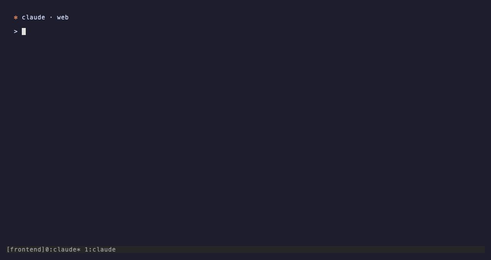

<p align="center"></p>

<p align="center">
  <b>A tmux popup that lists every open Claude Code session with its status, and takes you to any of them in two keystrokes.</b>
</p>

<p align="center">
  <a href="https://github.com/jstrah00/ccmcli/actions/workflows/ci.yml"></a>
  
  
  
  
  
</p>

## Why

When you run several Claude Code sessions in parallel, spread across tmux sessions and windows, `ccm` tells you at a glance which one is waiting for you, which one finished and which one is still working. `C-g` + a number and you're there.

<p align="center"></p>

- **Live status** for every session: waiting for input, working, finished and unseen, idle.
- **Jump by number** to the exact session, window and pane.
- **Your own order, names and status notes**, kept between openings.
- **Closed sessions** with fuzzy search: press `Enter` to resume one where it was, with its name and status.
- **Remote-control** sessions marked with a breathing `◉`.
- **Cheap:** the hook takes 3–7 ms, never writes to stdout and never breaks Claude Code.

Rows are grouped by tmux session. Each row shows a number, the state, the window (`:2`, plus the folder if it differs from the session name, or the name you give it with `r`), a status note (free text set with `s`; the column only shows up if some entry has one) and the conversation title. The bottom line shows the last prompt of the selected session.

## States

| | State |
|---|---|
| red `●` | waiting for your input (permission or question) |
| yellow `⠋` | working |
| green `✔` | finished and you haven't looked at it yet |
| gray `○` | idle / already seen |
| `?` | no data yet (session opened before the hooks were installed) |

Next to the state, a breathing blue `◉` marks sessions with remote-control on (the column only shows up if there is one). It comes from `bridgeSessionId` in `~/.claude/sessions/<pid>.json`, which Claude Code doesn't pass to hooks.

## Keys

| Key | Action |
|---|---|
| `j` / `k`, `gg` / `G` | move |
| `Enter` | go to that session, window and pane |
| `1`–`9` (and `10`+) | jump straight to that entry |
| `/` | filter (fuzzy); `Enter` keeps it, `Esc` clears it |
| `r` | rename the entry (replaces `:2 …`); empty restores the original |
| `dr` | rename starting from an empty input |
| `s` | set/edit the entry's status note; empty removes it |
| `ds` | remove the status note |
| `dd` | hide the entry (it stays in the registry) |
| `p` / `P` | paste it below / above: that's how you reorder |
| `U` | show all hidden entries again |
| `c` | closed sessions; type to search (fuzzy), `Enter` resumes it in a new window, `Esc` goes back |
| `q` / `Esc` | close |

Order, hidden entries and names persist between openings.

## Install

Requirements: tmux, Go ≥ 1.24, Claude Code. Works on Linux and macOS.

**1. Binary**

```sh
go install github.com/jstrah00/ccmcli/cmd/ccm@latest   # → ~/go/bin/ccm
```

**2. Claude Code hooks:** add to `"hooks"` in `~/.claude/settings.json` (they add up to the ones you already have):

```json
"SessionStart":     [{"hooks": [{"type": "command", "command": "$HOME/go/bin/ccm hook start"}]}],
"UserPromptSubmit": [{"hooks": [{"type": "command", "command": "$HOME/go/bin/ccm hook prompt"}]}],
"PreToolUse":       [{"matcher": "AskUserQuestion", "hooks": [{"type": "command", "command": "$HOME/go/bin/ccm hook ask"}]}],
"PostToolUse":      [{"hooks": [{"type": "command", "command": "$HOME/go/bin/ccm hook tool-done"}]}],
"Notification": [
  {"matcher": "permission_prompt", "hooks": [{"type": "command", "command": "$HOME/go/bin/ccm hook permission"}]},
  {"matcher": "idle_prompt",       "hooks": [{"type": "command", "command": "$HOME/go/bin/ccm hook idle"}]}
],
"Stop":             [{"hooks": [{"type": "command", "command": "$HOME/go/bin/ccm hook stop"}]}],
"SessionEnd":       [{"hooks": [{"type": "command", "command": "$HOME/go/bin/ccm hook end"}]}]
```

**3. tmux:** add to your `tmux.conf` and reload it (`tmux source-file ~/.config/tmux/tmux.conf`):

```tmux
bind-key -n C-g display-popup -E -h "60%" -w "80%" "$HOME/go/bin/ccm"
set-hook -g session-window-changed 'run-shell -b "$HOME/go/bin/ccm seen"'
set-hook -g client-session-changed 'run-shell -b "$HOME/go/bin/ccm seen"'
```

**4.** Restart your open Claude Code sessions so they pick up the hooks.

## How it works

- **State:** Claude Code hooks call `ccm hook <event>`, which writes one JSON file per pane in `~/.cache/ccm/panes/`. It never writes to stdout and always exits 0. If the session moved to the Claude Code daemon (it runs without `TMUX_PANE`), the hook finds its pane through the pty host; sessions outside tmux are ignored.
- **Seen:** tmux hooks call `ccm seen` when you switch window or session, and whatever you're looking at goes from `✔` to `○`.
- **List:** `tmux list-panes`, filtered to the panes running Claude Code (`claude`, or a version like `2.1.280` with the native binary), joined with those JSON files.
- **Closed:** `ccm hook end` and the cleanup of dead panes record them in `~/.local/state/ccm/closed.json` (last 50, only those that got at least one prompt). Resuming opens a window in the tmux session it was in (or the current one if that's gone) and types `claude --resume <id>` into a shell, so the shell stays when you quit Claude. It gets back its name and status, and leaves the list once it starts.
- **Titles:** from each session's transcript, read incrementally.
- **Order, names and status notes:** `~/.local/state/ccm/order.json`. `XDG_CACHE_HOME` and `XDG_STATE_HOME` are respected.
- **Remote-control:** `~/.claude/sessions/*.json` (or `$CLAUDE_CONFIG_DIR/sessions`).

## Commands

| | |
|---|---|
| `ccm` | opens the TUI (meant for `display-popup`) |
| `ccm hook <event>` | called by Claude Code hooks: `start`, `prompt`, `ask`, `permission`, `tool-done`, `idle`, `stop`, `end` |
| `ccm seen` | called by tmux hooks when you switch window or session |

## Troubleshooting

- **No sessions show up:** `tmux list-panes -a -F '#{pane_current_command}'` must show `claude` or a version number (`2.1.280`). If it shows `node` or something else, `ccm` won't detect them.
- **`ccm: must run inside tmux`:** the TUI needs `$TMUX`; open it with the `bind-key` above.
- **A session stays at `?`:** no hook has fired for it yet. Send it a prompt.
- **Hook error log:** `~/.cache/ccm/log`.

## Development

```sh
git clone https://github.com/jstrah00/ccmcli && cd ccmcli
go test ./...
go install ./cmd/ccm
```

The demo GIF is reproducible: `docs/demo/setup.sh && vhs docs/demo/demo.tape` (uses its own tmux server and fake sessions).

## License

[MIT](LICENSE)
